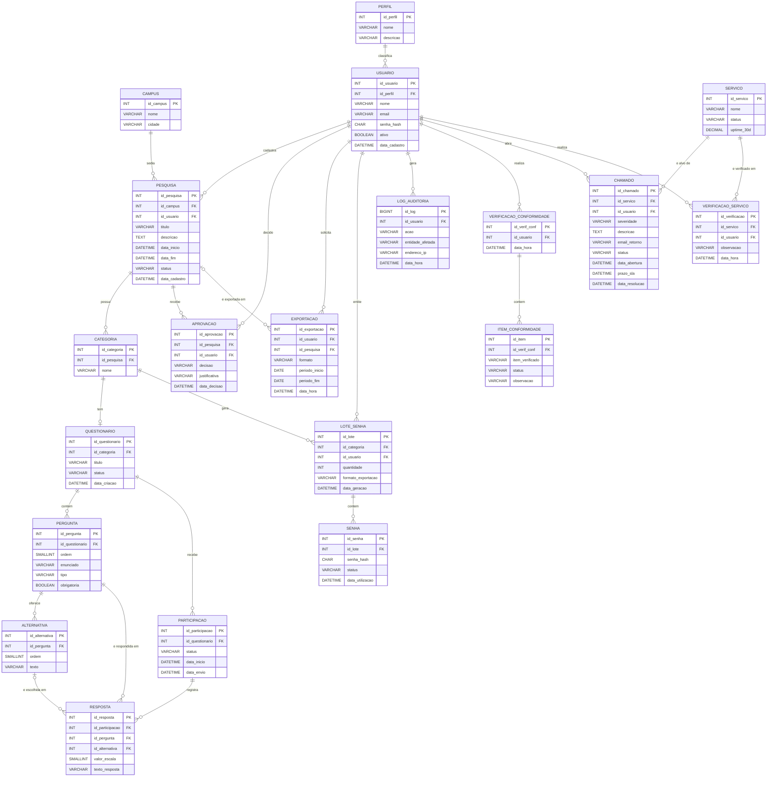

# MER — Sistema de Gestão de Pesquisas por Questionários

> Modelo lógico · Notação IE · Projeto Integrador I — ADS · Fatec Lins · 2026

## Sumário

- [Diagrama (Mermaid)](#diagrama-mermaid)
- [Entidades](#entidades)
  - Núcleo de pesquisa: [CAMPUS](#campus) · [PESQUISA](#pesquisa) · [CATEGORIA](#categoria) · [QUESTIONARIO](#questionario) · [PERGUNTA](#pergunta) · [ALTERNATIVA](#alternativa)
  - Coleta: [LOTE_SENHA](#lote_senha) · [SENHA](#senha) · [PARTICIPACAO](#participacao) · [RESPOSTA](#resposta)
  - Gestão: [APROVACAO](#aprovacao) · [EXPORTACAO](#exportacao)
  - Usuários e segurança: [PERFIL](#perfil) · [USUARIO](#usuario) · [LOG_AUDITORIA](#log_auditoria)
  - Conformidade: [VERIFICACAO_CONFORMIDADE](#verificacao_conformidade) · [ITEM_CONFORMIDADE](#item_conformidade)
  - Suporte e serviços: [SERVICO](#servico) · [CHAMADO](#chamado) · [VERIFICACAO_SERVICO](#verificacao_servico)
- [Relacionamentos](#relacionamentos)
- [Legenda](#legenda)

---

## Diagrama (Mermaid)

> Os tamanhos dos tipos (ex.: `VARCHAR(150)`) estão nas tabelas de cada entidade; no diagrama aparecem só os tipos base, para manter compatibilidade com o Mermaid.

---

## Entidades

### CAMPUS

| Atributo | Tipo | Chave |
|---|---|---|
| id_campus | INT | PK |
| nome | VARCHAR(80) | |
| cidade | VARCHAR(60) | |

### PESQUISA

| Atributo | Tipo | Chave |
|---|---|---|
| id_pesquisa | INT | PK |
| id_campus | INT | FK → CAMPUS |
| id_usuario | INT | FK → USUARIO |
| titulo | VARCHAR(150) | |
| descricao | TEXT | |
| data_inicio | DATETIME | |
| data_fim | DATETIME | |
| status | VARCHAR(20) | |
| data_cadastro | DATETIME | |

### CATEGORIA

| Atributo | Tipo | Chave |
|---|---|---|
| id_categoria | INT | PK |
| id_pesquisa | INT | FK → PESQUISA |
| nome | VARCHAR(60) | |

### QUESTIONARIO

| Atributo | Tipo | Chave |
|---|---|---|
| id_questionario | INT | PK |
| id_categoria | INT | FK → CATEGORIA |
| titulo | VARCHAR(150) | |
| status | VARCHAR(20) | |
| data_criacao | DATETIME | |

### PERGUNTA

| Atributo | Tipo | Chave |
|---|---|---|
| id_pergunta | INT | PK |
| id_questionario | INT | FK → QUESTIONARIO |
| ordem | SMALLINT | |
| enunciado | VARCHAR(500) | |
| tipo | VARCHAR(20) | |
| obrigatoria | BOOLEAN | |

### ALTERNATIVA

| Atributo | Tipo | Chave |
|---|---|---|
| id_alternativa | INT | PK |
| id_pergunta | INT | FK → PERGUNTA |
| ordem | SMALLINT | |
| texto | VARCHAR(150) | |

### LOTE_SENHA

| Atributo | Tipo | Chave |
|---|---|---|
| id_lote | INT | PK |
| id_categoria | INT | FK → CATEGORIA |
| id_usuario | INT | FK → USUARIO |
| quantidade | INT | |
| formato_exportacao | VARCHAR(5) | |
| data_geracao | DATETIME | |

### SENHA

| Atributo | Tipo | Chave |
|---|---|---|
| id_senha | INT | PK |
| id_lote | INT | FK → LOTE_SENHA |
| senha_hash | CHAR(64) | |
| status | VARCHAR(15) | |
| data_utilizacao | DATETIME | |

### PARTICIPACAO

| Atributo | Tipo | Chave |
|---|---|---|
| id_participacao | INT | PK |
| id_questionario | INT | FK → QUESTIONARIO |
| status | VARCHAR(15) | |
| data_inicio | DATETIME | |
| data_envio | DATETIME | |

### RESPOSTA

| Atributo | Tipo | Chave |
|---|---|---|
| id_resposta | INT | PK |
| id_participacao | INT | FK → PARTICIPACAO |
| id_pergunta | INT | FK → PERGUNTA |
| id_alternativa | INT | FK → ALTERNATIVA (opcional) |
| valor_escala | SMALLINT | |
| texto_resposta | VARCHAR(500) | |

### APROVACAO

| Atributo | Tipo | Chave |
|---|---|---|
| id_aprovacao | INT | PK |
| id_pesquisa | INT | FK → PESQUISA |
| id_usuario | INT | FK → USUARIO |
| decisao | VARCHAR(10) | |
| justificativa | VARCHAR(500) | |
| data_decisao | DATETIME | |

### EXPORTACAO

| Atributo | Tipo | Chave |
|---|---|---|
| id_exportacao | INT | PK |
| id_usuario | INT | FK → USUARIO |
| id_pesquisa | INT | FK → PESQUISA (opcional) |
| formato | VARCHAR(5) | |
| periodo_inicio | DATE | |
| periodo_fim | DATE | |
| data_hora | DATETIME | |

### PERFIL

| Atributo | Tipo | Chave |
|---|---|---|
| id_perfil | INT | PK |
| nome | VARCHAR(40) | |
| descricao | VARCHAR(200) | |

### USUARIO

| Atributo | Tipo | Chave |
|---|---|---|
| id_usuario | INT | PK |
| id_perfil | INT | FK → PERFIL |
| nome | VARCHAR(100) | |
| email | VARCHAR(120) | |
| senha_hash | CHAR(64) | |
| ativo | BOOLEAN | |
| data_cadastro | DATETIME | |

### LOG_AUDITORIA

| Atributo | Tipo | Chave |
|---|---|---|
| id_log | BIGINT | PK |
| id_usuario | INT | FK → USUARIO |
| acao | VARCHAR(200) | |
| entidade_afetada | VARCHAR(40) | |
| endereco_ip | VARCHAR(45) | |
| data_hora | DATETIME | |

### VERIFICACAO_CONFORMIDADE

| Atributo | Tipo | Chave |
|---|---|---|
| id_verif_conf | INT | PK |
| id_usuario | INT | FK → USUARIO |
| data_hora | DATETIME | |

### ITEM_CONFORMIDADE

| Atributo | Tipo | Chave |
|---|---|---|
| id_item | INT | PK |
| id_verif_conf | INT | FK → VERIFICACAO_CONFORMIDADE |
| item_verificado | VARCHAR(100) | |
| status | VARCHAR(15) | |
| observacao | VARCHAR(300) | |

### SERVICO

| Atributo | Tipo | Chave |
|---|---|---|
| id_servico | INT | PK |
| nome | VARCHAR(80) | |
| status | VARCHAR(15) | |
| uptime_30d | DECIMAL(5,2) | |

### CHAMADO

| Atributo | Tipo | Chave |
|---|---|---|
| id_chamado | INT | PK |
| id_servico | INT | FK → SERVICO |
| id_usuario | INT | FK → USUARIO |
| severidade | VARCHAR(10) | |
| descricao | TEXT | |
| email_retorno | VARCHAR(120) | |
| status | VARCHAR(20) | |
| data_abertura | DATETIME | |
| prazo_sla | DATETIME | |
| data_resolucao | DATETIME | |

### VERIFICACAO_SERVICO

| Atributo | Tipo | Chave |
|---|---|---|
| id_verificacao | INT | PK |
| id_servico | INT | FK → SERVICO |
| id_usuario | INT | FK → USUARIO |
| observacao | VARCHAR(500) | |
| data_hora | DATETIME | |

---

## Relacionamentos

| Lado "um" | Cardinalidade | Lado "muitos" / dependente | FK |
|---|---|---|---|
| CAMPUS | 1 : 0..N | PESQUISA | PESQUISA.id_campus |
| USUARIO | 1 : 0..N | PESQUISA | PESQUISA.id_usuario |
| PESQUISA | 1 : 0..N | CATEGORIA | CATEGORIA.id_pesquisa |
| CATEGORIA | 1 : 0..1 | QUESTIONARIO | QUESTIONARIO.id_categoria |
| QUESTIONARIO | 1 : 0..N | PERGUNTA | PERGUNTA.id_questionario |
| PERGUNTA | 1 : 0..N | ALTERNATIVA | ALTERNATIVA.id_pergunta |
| PESQUISA | 1 : 0..N | APROVACAO | APROVACAO.id_pesquisa |
| USUARIO | 1 : 0..N | APROVACAO | APROVACAO.id_usuario |
| PESQUISA | 0..1 : 0..N | EXPORTACAO | EXPORTACAO.id_pesquisa (opcional) |
| USUARIO | 1 : 0..N | EXPORTACAO | EXPORTACAO.id_usuario |
| CATEGORIA | 1 : 0..N | LOTE_SENHA | LOTE_SENHA.id_categoria |
| USUARIO | 1 : 0..N | LOTE_SENHA | LOTE_SENHA.id_usuario |
| LOTE_SENHA | 1 : 0..N | SENHA | SENHA.id_lote |
| QUESTIONARIO | 1 : 0..N | PARTICIPACAO | PARTICIPACAO.id_questionario |
| PARTICIPACAO | 1 : 0..N | RESPOSTA | RESPOSTA.id_participacao |
| PERGUNTA | 1 : 0..N | RESPOSTA | RESPOSTA.id_pergunta |
| ALTERNATIVA | 0..1 : 0..N | RESPOSTA | RESPOSTA.id_alternativa (opcional) |
| PERFIL | 1 : 0..N | USUARIO | USUARIO.id_perfil |
| USUARIO | 1 : 0..N | LOG_AUDITORIA | LOG_AUDITORIA.id_usuario |
| USUARIO | 1 : 0..N | VERIFICACAO_CONFORMIDADE | VERIFICACAO_CONFORMIDADE.id_usuario |
| VERIFICACAO_CONFORMIDADE | 1 : 0..N | ITEM_CONFORMIDADE | ITEM_CONFORMIDADE.id_verif_conf |
| USUARIO | 1 : 0..N | CHAMADO | CHAMADO.id_usuario |
| SERVICO | 1 : 0..N | CHAMADO | CHAMADO.id_servico |
| SERVICO | 1 : 0..N | VERIFICACAO_SERVICO | VERIFICACAO_SERVICO.id_servico |
| USUARIO | 1 : 0..N | VERIFICACAO_SERVICO | VERIFICACAO_SERVICO.id_usuario |

---

## Legenda

Notação IE (Information Engineering):

| Símbolo | Mermaid | Significado |
|---|---|---|
| `‖` (dois traços) | `\|\|` | Exatamente um (FK obrigatória) |
| `○‖` (traço + círculo) | `\|o` / `o\|` | Zero ou um (FK opcional / relação 1:1) |
| `○<` (círculo + pé de galinha) | `o{` / `}o` | Zero ou muitos |

- Linha tracejada = relacionamento não identificador.
- **PK** = chave primária · **FK** = chave estrangeira.
