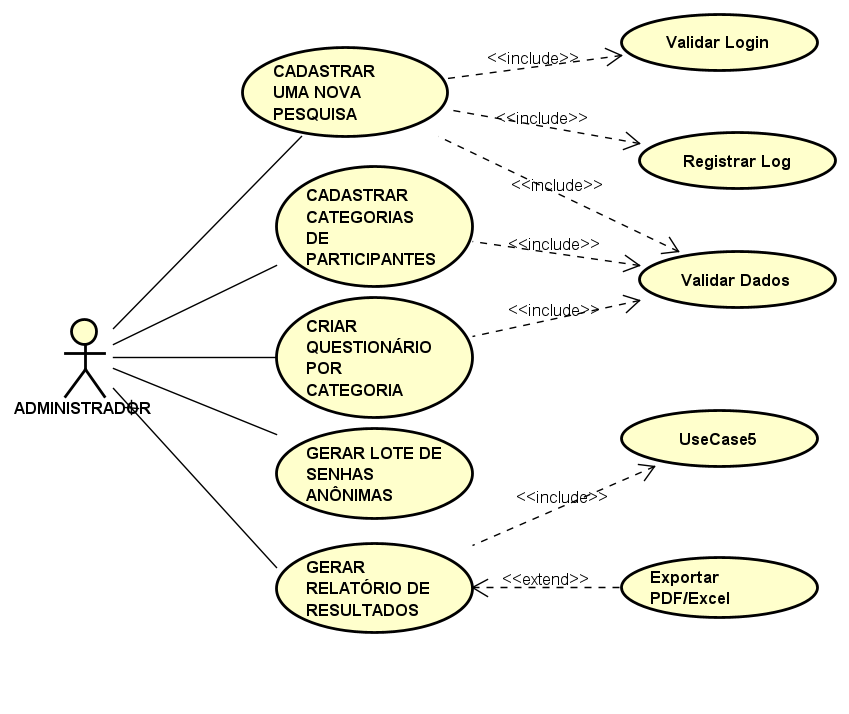
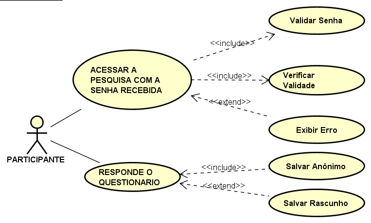
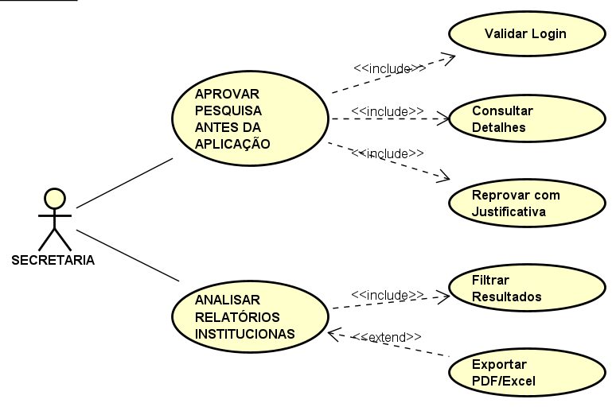
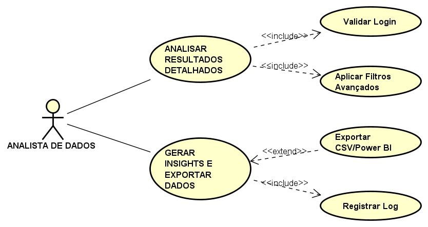
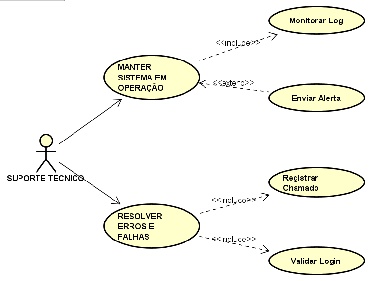
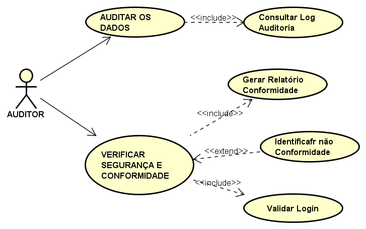

### CENTRO ESTADUAL DE EDUCAÇÃO TECNOLÓGICA PAULA SOUZA

**Curso de Análise e Desenvolvimento de Sistemas**

Anderson Clayton Pereira de Assis

Anderson Porto Abrantes

Eduardo Matias Ferreira

Poliana da Silva Benedito

## ESTUDO DE CASO

Levantamento e Análise de Requisitos

**Lins-SP 2026**

Anderson Clayton Pereira de Assis

Anderson Porto Abrantes

Eduardo Matias Ferreira

Poliana da Silva Benedito

### ESTUDO DE CASO

Levantamento e Análise de Requisitos

Estudo de caso apresentado como atividade avaliativa da disciplina de Engenharia de Software do curso superior em Análise e Desenvolvimento de Sistemas do Centro Estadual de Educação Tecnológica Paula Souza.

Professor: Alciano Gustavo Genovez De Oliveira

**Lins-SP 2026**

## Fatec Lins - ADS -Projeto Integrador I

**Sistema Web para Gestão de Pesquisas por Ǫuestionários**

### Apresentação

O projeto tem como objetivo proporcionar aos estudantes uma experiência prática de desenvolvimento de software, envolvendo análise de requisitos, modelagem de dados, desenvolvimento de aplicações web, usabilidade, segurança da informação e geração de relatórios analíticos.

O sistema a ser desenvolvido deverá permitir a criação, aplicação e análise de pesquisas institucionais, garantindo anonimato dos participantes e organização das respostas por categorias de respondentes.

### Objetivo do Projeto

Desenvolver um Sistema Web para Gestão de Pesquisas por Questionários, permitindo:

Cadastro e gerenciamento de pesquisas

Definição de categorias de participantes

Criação de questionários específicos por categoria

Aplicação da pesquisa com acesso por senha anônima

Coleta e armazenamento das respostas

Monitoramento da participação

Geração de relatórios estatísticos

O sistema deverá permitir a realização de pesquisas institucionais de forma organizada, segura e anônima.

### Escopo do Sistema

O sistema deverá contemplar os seguintes módulos funcionais:

### Módulo de Cadastro de Pesquisa

Responsável pela criação e configuração das pesquisas.

Funcionalidades mínimas:

### Cadastro de pesquisas

Definição de:

título da pesquisa

descrição

período de aplicação (data início e fim)

status (ativa/inativa)

Cadastro de categorias de participantes

Exemplo de categorias:

Alunos

Professores

Colaboradores

Cada pesquisa poderá possuir uma ou mais categorias de participantes.

### Módulo de Questionários

Responsável pela criação das perguntas da pesquisa.

### Funcionalidades:

Cadastro de questões

Associação das questões a uma categoria de participante

Cadastro de alternativas de resposta

Tipos de questões sugeridos:

Múltipla escolha (uma resposta)

Múltipla escolha (várias respostas)

Escala (ex: 1 a 5)

Resposta aberta (texto)

Cada categoria poderá possuir seu próprio questionário.

### Módulo de Geração de Senhas

O sistema deverá permitir a geração de senhas de acesso anônimas.

Características:

Senhas aleatórias

Associadas a uma categoria de participante

Não devem identificar o respondente

Cada senha deve permitir apenas uma resposta Funcionalidades:

Gerar lote de senhas por categoria

Exportar senhas (PDF ou CSV)

Marcar senha como utilizada

### Módulo de Aplicação da Pesquisa (Coleta de Dados)

Interface para os participantes responderem a pesquisa.

Fluxo de uso:

Usuário acessa o sistema

Digita a senha recebida

Sistema identifica a categoria

Exibe o questionário correspondente

Usuário responde as perguntas

Sistema grava as respostas no banco de dados

Senha é marcada como utilizada Requisitos:

Interface simples e responsiva

Validação de respostas obrigatórias

Impedir múltiplas respostas com a mesma senha

### Módulo de Gestão (Dashboard)

Interface administrativa para acompanhamento da pesquisa.

Indicadores sugeridos:

Total de senhas geradas

Total de respostas recebidas

Taxa de participação

Participação por categoria

### Módulo de Relatórios

O sistema deverá permitir a geração de relatórios analíticos.

Relatórios sugeridos:

Resultado por pergunta

Resultado por categoria

Comparação entre categorias

Exportação de resultados (PDF, CSV)

Visualização em tela com gráficos

### Requisitos Funcionais

O sistema deverá permitir:

Cadastrar pesquisas

Cadastrar categorias de participantes

Criar questionários por categoria

Cadastrar perguntas e alternativas

Gerar senhas anônimas

Aplicar questionários via senha

Registrar respostas no banco de dados

Impedir reutilização de senhas

Monitorar participação em tempo real

Gerar relatórios estatísticos

### Requisitos Não Funcionais

O sistema deverá atender aos seguintes requisitos:

Usabilidade

Interface web amigável

Layout responsivo

Segurança

Senhas criptografadas no banco

Validação de acesso

Proteção contra múltiplas respostas

Performance

Sistema capaz de suportar múltiplos acessos simultâneos

Portabilidade

Funcionamento em navegadores modernos

### Requisitos Tecnológicos

Utilizar tecnologias modernas de desenvolvimento web.

Sugestão de stack:

| Backend: PHP (Laravel) Node.js Java Spring Boot | Frontend: HTML5 CSS3 Bootstrap JavaScript React (opcional) | Banco de dados: MySQL PostgreSQL |

| --- | --- | --- |

Outras tecnologias sugeridas:

APIs REST

Docker (opcional)

Git/GitHub para versionamento

# Requisitos Funcionais

*Os requisitos funcionais descrevem o que o sistema deve fazer — as funcionalidades que deverão ser implementadas para atender às necessidades dos usuários.*

| ID | Descrição |

| --- | --- |

| RF01 | Cadastrar pesquisas |

| RF02 | Cadastrar categorias de participantes |

| RF03 | Criar questionários por categoria |

| RF04 | Cadastrar perguntas e alternativas de resposta |

| RF05 | Gerar senhas anônimas por lote e por categoria |

| RF06 | Exportar senhas geradas (PDF ou CSV) |

| RF07 | Aplicar questionários via senha anônima |

| RF08 | Registrar respostas no banco de dados |

| RF09 | Impedir reutilização de senhas |

| RF10 | Monitorar participação em tempo real (dashboard) |

| RF11 | Gerar relatórios estatísticos por pergunta, categoria e comparativos |

| RF12 | Exportar resultados em PDF e CSV |

# Requisitos Não Funcionais

*Os requisitos não funcionais definem as qualidades e restrições do sistema, como desempenho, segurança, usabilidade e portabilidade.*

| ID | Categoria | Descrição |

| --- | --- | --- |

| RNF01 | Usabilidade | Interface web amigável e layout responsivo, acessível em dispositivos móveis e desktops. |

| RNF02 | Segurança | Senhas criptografadas no banco, validação de acesso e proteção contra múltiplas respostas. |

| RNF03 | Performance | O sistema deve suportar múltiplos acessos simultâneos sem degradação de desempenho. |

| RNF04 | Portabilidade | Funcionamento em navegadores modernos (Chrome, Firefox, Edge, Safari). |

| RNF05 | Anonimato | Nenhuma resposta deve poder ser rastreada ao respondente individualmente. |

# Atores

*Os atores representam os perfis de usuários que interagem com o sistema.*

| Ator | Descrição |

| --- | --- |

|  Administrador | Responsável por criar e gerenciar pesquisas, categorias, questionários, senhas e relatórios. Tem acesso total ao sistema. |

|  Participante | Usuário que recebe uma senha anônima e responde ao questionário correspondente à sua categoria. Não possui conta no sistema. |

| Secretaria | Responsável por aprovar pesquisas antes de sua aplicação e analisar relatórios para subsidiar decisões institucionais. |

| Analista de Dados | Responsável por analisar os resultados das pesquisas, gerar insights e exportar dados para uso externo. |

| Suporte Técnico | Responsável pela manutenção do sistema, resolução de erros e garantia de continuidade operacional. |

| Auditor | Responsável por auditar os dados coletados, verificar a segurança do sistema e garantir conformidade com normas. |

# User Stories

*As User Stories descrevem as funcionalidades do sistema do ponto de vista do usuário, no formato: Ator — Ação — Resultado esperado.*

| Ator | Ação do Usuário | Resultado Esperado |

| --- | --- | --- |

|  Administrador |  Cadastrar uma nova pesquisa | O sistema registra a pesquisa com título, descrição, período e status. |

|  Administrador | Cadastrar categorias de participantes | O sistema associa as categorias (ex: Alunos, Professores) à pesquisa. |

| Administrador | Criar questionário por categoria | O sistema vincula as perguntas à categoria selecionada. |

|  Administrador |  Gerar lote de senhas anônimas por categoria | O sistema gera senhas aleatórias associadas à categoria, sem identificar o respondente. |

|  Administrador |  Gerar relatório de resultados | O sistema exibe gráficos e permite exportação em PDF ou CSV. |

|  Participante | Acessar a pesquisa com a senha recebida | O sistema identifica a categoria do participante e exibe o questionário correspondente. |

|  Participante |  Responder o questionário | O sistema valida as respostas obrigatórias e grava as respostas no banco de dados. |

| Secretaria | Aprovar pesquisas antes da aplicação | O sistema libera a pesquisa para aplicação após aprovação. |

|  Secretaria |  Analisar relatórios institucionais | O sistema fornece dados consolidados para apoio à tomada de decisão. |

| Analista de Dados |  Analisar resultados detalhados | O sistema exibe gráficos detalhados por categoria e pergunta. |

| Analista de Dados |  Gerar insights e exportar dados | O sistema permite exportação dos dados para análises externas. |

| Suporte Técnico |  Manter o sistema em operação | O sistema continua funcionando corretamente após manutenção. |

| Suporte Técnico | Resolver erros e falhas | As falhas são corrigidas e o |

| Ator | Ação do Usuário | Resultado Esperado |

| --- | --- | --- |

| (Continuação) | (Continuação) | sistema retorna à normalidade. |

| Auditor | Auditar os dados coletados | O sistema garante integridade e rastreabilidade dos dados. |

| Auditor | Verificar segurança e conformidade | A conformidade com normas de segurança é validada. |

**DIAGRAMA DE CASO DE USO**

**Ator: Administrativo**

**US- Administrador**

O Administrador tem total controle sobre o ciclo de vida das pesquisas, gerenciamento de categorias, questionários e geração de senhas anônimas.

**Caso de Uso: *****Cadastrar Nova Pesquisa (US-ADM-01)***

***Fluxo Principal***

O Administrador acessa a área de gestão e autentica-se no sistema.

O Administrador clica em "Nova Pesquisa".

O Administrador insere o Título (entre 5 e 100 caracteres), descrição e o Período de aplicação (data/hora de início e fim).

O Administrador clica em "Salvar".

O sistema valida que as regras e campos obrigatórios foram preenchidos corretamente.

O sistema persiste os dados no banco com o status inicial "Rascunho".

O sistema registra a operação na trilha de auditoria

O sistema exibe uma mensagem de sucesso na tela.

***Fluxo Alternativo (Período Inválido):***

No passo 3 do fluxo principal, o Administrador insere uma data de fim anterior à data de início, ou uma data retroativa.

No passo 5, a validação de dados do sistema detecta a inconsistência temporal.

O sistema interrompe o processo de salvamento.

O sistema exibe a mensagem de erro: *"Data fim deve ser posterior à data início."*

O sistema mantém os campos preenchidos na tela para que o Administrador faça a correção.

**Caso de Uso: Cadastrar Categorias de Participantes (US-ADM-02)**

***Fluxo Principal***

O Administrador acessa o módulo de categorias.

O Administrador digita o nome de uma nova categoria (ex: Alunos, Professores) limitado a 50 caracteres.

O Administrador clica em "Adicionar Categoria".

O sistema valida se o nome é preenchido e único (Validar Dados).

O sistema salva a nova categoria e a vincula à pesquisa em edição.

***Fluxo Alternativo (Nome Duplicado)***

No passo 2 do fluxo principal, o Administrador digita o nome de uma categoria já existente no sistema (tratada de forma *case-insensitive*).

No passo 4, o sistema identifica que já existe um registro correspondente na base de dados inseridos.

O sistema bloqueia a inserção.

O sistema exibe o alerta: *"Categoria já existe*

**Caso de Uso: Criar Questionário por Categoria (US-ADM-03)**

***Fluxo Principal***

O Administrador seleciona uma categoria de participantes previamente cadastrada.

O Administrador insere as perguntas (entre 1 e 50) e define os tipos (múltipla escolha, escala Likert ou aberta).

O Administrador configura as alternativas correspondentes e marca as questões obrigatórias.

O Administrador clica em "Salvar Questionário".

O sistema valida o questionário

O sistema associa a estrutura criada exclusivamente àquela categoria.

***Fluxo Alternativo***

No passo 4 do fluxo principal, o Administrador tenta salvar o questionário estrutural sem ter incluído nenhuma pergunta.

O sistema realiza a validação e constata que o mínimo de 1 pergunta não foi atingido.

O sistema não grava as informações no banco.

O sistema exibe o aviso: *"Adicione pelo menos 1 pergunta."*

**Caso de Uso: Gerar Lote de Senhas Anônimas (US-ADM-04)**

***Fluxo Principal***

O Administrador informa a quantidade de senhas que deseja gerar e escolhe a categoria de participantes correspondente.

O Administrador clica em "Gerar Lote".

O sistema gera strings aleatórias e únicas de 8 caracteres alfanuméricos (Associar à Categoria).

O sistema calcula a assinatura hash (SHA-256) de cada senha gerada (Gerar Hash de Senha).

O sistema armazena os hashes no banco sem qualquer associação com dados pessoais identificáveis (respeitando a LGPD e o anonimato).

O sistema disponibiliza o lote em texto puro estritamente para download imediato.

***Fluxo Alternativo (Quantidade Zero ou Inválida):***

No passo 1 do fluxo principal, o Administrador insere o valor 0 (zero) ou um caractér inválido no campo de quantidade de senhas.

O Administrador clica em "Gerar Lote".

O sistema intercepta a requisição na camada de validação.

O sistema exibe a mensagem de erro: *"Informe quantidade maior que zero."*

**Caso de Uso: Gerar Relatório de Resultados (US-ADM-05)**

***Fluxo Principal***

O Administrador acessa a aba de relatórios e aplica os filtros obrigatórios (Pesquisa e Período)

O Administrador solicita a consolidação dos dados.

O sistema executa uma consulta agregada na base de dados para totalizar percentuais e contadores.

O sistema exibe os resultados na tela por meio de gráficos analíticos em menos de 5 segundos.

***Fluxo Alternativo***

No passo 2 do fluxo principal, após a aplicação dos filtros, o sistema realiza a busca mas constata que nenhum participante respondeu à pesquisa naquele período.

O mecanismo gráfico é suprimido para evitar renderizações em branco.

O sistema exibe o aviso na tela: *"Nenhuma resposta encontrada para os filtros."*

**US-ADM-01** – Cadastrar Nova Pesquisa

Como **Administrador**, quero cadastrar uma nova pesquisa informando título, para definir título, descrição e período."

Fluxo principal: Login → Preencher dados → Validar → Salvar

**<<include>>:** Validar Login, Validar Dados Obrigatórios, Registrar Log de Auditoria

**<<extend>>:** Duplicar Pesquisa Existente

Fluxos alternativos:

**Título vazio** → Mensagem: "Título é obrigatório."

**Período inválido** → Mensagem: "Data fim deve ser posterior à data início."

**Sessão expirada** → Mensagem: "Sua sessão expirou. Faça login novamente."

**Critérios:**

Título com 5-100 caracteres obrigatório

Período deve ser futuro e fim > início

Pesquisa criada inicia com status "Rascunho"

Log registra usuário, data/hora e ação

**US-ADM-02** – Cadastrar Categorias de Participantes

Como **Administrador**, quero cadastrar categorias (ex: alunos, professores), para segmentar o público-alvo

**<<include>>:** Validar Dados

Fluxos alternativos:

**Nome duplicado** → "Categoria já existe."

**Nome vazio** → "Informe um nome válido."

**Critérios:**

Nome único (case-insensitive)

Não permite exclusão se categoria estiver em uso

Máximo 50 caracteres

**US-ADM-03** – Criar Questionário por Categoria

Como **Administrador**, quero criar questionário vinculado a uma categoria, para adequar perguntas ao perfil

**<<include>>:** Validar Dados, Adicionar Perguntas

**<<extend>>:** Importar Modelo de Perguntas

Fluxos alternativos:

**Sem perguntas** → "Adicione pelo menos 1 pergunta."

**Critérios:**

Mínimo 1 pergunta, máximo 50

Tipos permitidos: múltipla escolha, escala Likert, aberta

Perguntas obrigatórias marcadas visualmente

**US-ADM-04** – Gerar Lote de Senhas Anônimas

Como **Administrador**, quero gerar lote de senhas anônimas, para distribuir acessos seguros sem identificar participantes

**<<include>>:** Gerar Hash de Senha, Associar à Categoria

Fluxos alternativos: * Quantidade zero → "Informe quantidade maior que zero."

**Falha geração** → "Erro ao gerar senhas. Tente novamente."

**Critérios:**

Senhas com 8 caracteres alfanuméricos únicos

Hash SHA-256 armazenado, senha em texto apenas na exportação

Nenhum vínculo com CPF, e-mail ou nome (LGPD) 4. Lote exportável em CSV

**US-ADM-05** – Gerar Relatório de Resultados

Como **Administrador**, quero gerar relatório de resultados, para acompanhar desempenho da pesquisa

**<<include>>:** Filtrar por Período/Categoria

**<<extend>>:** Exportar para PDF/Excel

Fluxos alternativos:

**Sem dados** → "Nenhuma resposta encontrada para os filtros."

**Critérios:**

Exibe apenas dados agregados (% e totais)

Nunca exibe resposta individual

Filtros obrigatórios: pesquisa + período

Exportação em <5 segundos para até 10mil respostas

### Ator: Participante

**US-Ator: Participante**

*O Participante é o usuário final que interage com o sistema exclusivamente para responder às pesquisas sob total anonimato, acessando apenas por senha.*

#### *Caso de Uso: Acessar Pesquisa com Senha*

#### *Fluxo Principal*

*O Participante acessa a URL pública do sistema.*

*O Participante digita a senha alfanumérica recebida e clica em "Acessar".*

*O sistema busca a senha em formato Hash SHA-256 no banco de dados*

*O sistema valida que a pesquisa correspondente está no período de vigência ativa*

*O sistema identifica a categoria vinculada àquela senha e renderiza o questionário apropriado em menos de 2 segundos.*

***Fluxo Alternativo***

*No passo 2 do fluxo principal, o Participante insere uma senha que já foi enviada e computada anteriormente.*

*No passo 3, o sistema localiza o registro do hash correspondente, mas detecta que o status da senha está marcado como "Utilizada".*

*O sistema bloqueia a exibição do questionário (* Exibir Erro*).*

*O sistema exibe a mensagem de restrição: "Esta senha já foi utilizada."

*

#### *Caso de Uso: Responder Questionário (US-PAR-02)*

***Fluxo Principal***

*O Participante responde sequencialmente às perguntas exibidas em uma interface responsiva/móvel.*

*O sistema salva automaticamente o progresso a cada pergunta respondida (*Salvar Rascunho e Continuar Depois*).*

*O Participante preenche todas as perguntas marcadas como obrigatórias e clica em "Concluir/Enviar".*

*O sistema verifica a integridade de todas as respostas fornecidas.*

*O sistema grava as respostas de forma totalmente anonimizada, sem registrar IP, cookies ou IDs (*Salvar Resposta Anônima*).*

*O sistema altera o status da senha usada para "Utilizada" no banco de dados para impedir fraudes.*

*O sistema exibe uma tela de confirmação de envio com sucesso*

***Fluxo Alternativo (Pergunta Obrigatória não Respondida):***

*No passo 3 do fluxo principal, o Participante tenta submeter o questionário final deixando uma ou mais perguntas obrigatórias sem preenchimento.*

*No passo 4, a validação de dados em nível de aplicação barra o envio.*

*As respostas não são gravadas definitivamente no banco principal.*

*O sistema rola a tela até a pergunta pendente, destaca-a visualmente e exibe o alerta: "Responda todas as perguntas obrigatórias."*

**US-PAR-01** – Acessar Pesquisa com Senha

Como **Participante**, quero acessar com a senha recebida, para responder mantendo anonimato

**<<include>>:** Validar Senha, Verificar Validade da Pesquisa

**<<extend>>:** Exibir Erro "Senha inválida ou expirada"

Fluxos alternativos:

**Senha inválida** → "Senha não encontrada. Tentativa 1 de 3."

**3 tentativas** → "Acesso bloqueado temporariamente."

**Pesquisa expirada** → "Esta pesquisa não está mais disponível."

**Já respondida** → "Esta senha já foi utilizada."

**Critérios:**

Máximo 3 tentativas por IP em 15 min

Não armazena IP, cookie ou identificação

Senha válida apenas no período da pesquisa

Acesso em <2 segundos

**US-PAR-02** – Responder Questionário

Como **Participante**, quero responder de forma simples e rápida, para concluir em menos de 5 minutos

**<<include>>:** Salvar Resposta Anônima

**<<extend>>:** Salvar Rascunho e Continuar Depois

Fluxos alternativos:

**Pergunta obrigatória vazia** → "Responda todas as perguntas obrigatórias."

**Falha conexão** → "Não foi possível enviar. Respostas salvas localmente."

**Critérios:**

Interface mobile-first

Progresso salvo automaticamente a cada pergunta

Confirmação final não armazena identificador

Tempo médio de resposta <5 min

**Ator: Secretaria**

**US – Secretaria**

*A Secretaria atua na governança, validando as pesquisas propostas e usando os relatórios institucionais para subsidiar decisões táticas.*

#### *Caso de Uso: Aprovar Pesquisas Antes da Aplicação*

#### *Fluxo Principal*

*O integrante da Secretaria faz login no painel restrito institucional*

*O usuário filtra e seleciona uma pesquisa que esteja com o status "Em análise".*

*O usuário revisa toda a descrição, categorias e perguntas estruturadas*

*O usuário clica na opção "Aprovar Pesquisa".*

*O sistema altera o status da pesquisa para "Aprovada", habilitando a geração/liberação das senhas pelo administrador.*

*O sistema dispara uma notificação interna automatizada informando o Administrador.*

***Fluxo Alternativo (Reprovação com Justificativa Obrigatória):***

*No passo 4 do fluxo principal, o usuário da Secretaria identifica que o questionário fere políticas internas e clica em "Reprovar Pesquisa" (*Reprovar com Justificativa*).*

*O usuário tenta salvar a reprovação sem preencher o campo de texto explicativo.*

*O sistema interrompe a gravação e valida que a justificativa exige ao menos 10 caracteres.*

*O sistema emite o alerta: "Informe o motivo da reprovação."*

*O status da pesquisa é preservado em análise até o preenchimento válido da justificativa.*

#### *Caso de Uso: Analisar Relatórios Institucionais*

***Fluxo Principal***

*O usuário da Secretaria acessa o painel macro de inteligência institucional.*

*O usuário aplica filtros de visualização com base na unidade ou campus universitário (*Filtrar Resultados*).*

*O sistema processa e exibe em tela os dados consolidados e agregados de forma institucional e gráfica, omitindo qualquer dado individual.*

*O usuário opta por documentar e clica em "Exportar Relatório" (*Exportar PDF/Excel*).*

*O sistema gera um documento estruturado contendo o brasão e a identidade visual oficial da instituição.*

***Fluxo Alternativo (Ausência de Amostragem no Filtro):***

*No passo 2 do fluxo principal, o usuário escolhe um período ou campus específico onde nenhuma categoria de respondente registrou respostas.*

*O sistema faz a verificação na base de dados analítica e retorna zero registros.*

*O sistema cancela a operação de exportação de layout em branco.*

*O sistema exibe o aviso na interface: "Nenhum dado para o período selecionado."*

**US-SEC-01** – Aprovar Pesquisas

Como **Secretaria**, quero aprovar pesquisas antes da liberação, para garantir conformidade institucional

**<<include>>:** Validar Login, Consultar Detalhes

**<<extend>>:** Reprovar com Justificativa

Fluxos alternativos:

**Sem permissão** → "Você não tem permissão para aprovar."

**Reprovar sem motivo** → "Informe o motivo da reprovação."

**Critérios:**

Apenas pesquisas com status "Em análise" aparecem

Aprovação muda status para "Aprovada" e libera senhas

Reprovação exige justificativa mínima 10 caracteres

Notificação automática ao administrador

**US-SEC-02** – Analisar Relatórios Institucionais

Como **Secretaria**, quero analisar relatórios consolidados, para apoiar decisões estratégicas

**<<include>>:** Filtrar Resultados (reusa do Admin)

**<<extend>>:** Exportar PDF/Excel

Fluxos alternativos:

**Sem dados **→ "Nenhum dado para o período selecionado."

**Critérios:**

Visão por unidade/campus

Dados agregados, sem identificação

Exportação com brasão institucional

** Ator: Analista de Dados**

### *US:Ator: Analista de Dados

**O Analista de Dados explora os resultados sob uma ótica estatística profunda e exporta dados consolidados para ferramentas de BI.

**Caso de Uso: Analisar Resultados Detalhados (US-analista)*

***          Fluxo Principal***

*O Analista de Dados realiza login com seu perfil técnico (*Validar Login*).*

*O Analista acessa a central de mineração de dados da pesquisa.*

*O Analista define filtros avançados combinando categoria, intervalos de períodos e cruzamento de perguntas (*Aplicar Filtros Avançados*).*

*O sistema processa as queries analíticas e renderiza gráficos complexos de correlação na tela em até 3 segundos.*

***           Fluxo Alternativo (Filtros não Selecionados):***

*No passo 3 do fluxo principal, o Analista clica em "Processar Gráficos" deixando todos os critérios de busca e filtros em branco.*

*O sistema recusa o processamento em massa para evitar sobrecarga ou quebra de escopo.*

*O sistema gera o alerta de validação: "Selecione pelo menos um critério."*

#### *Caso de Uso: Gerar Insights e Exportar Dados (US-analista-02)*

***Fluxo Principal***

*O Analista de Dados solicita a extração em lote dos resultados agregados da pesquisa para integração com ferramentas como, por exemplo, o Power BI (*Exportar CSV/Power BI*).*

*O sistema compila as tabelas aplicando uma rotina rígida de anonimização obrigatória (removendo qualquer rastro individual).*

*O sistema gera os arquivos brutos nos formatos estruturados *.csv* ou *.xlsx*.*

*O sistema grava o evento na tabela de segurança (*Registrar Log*), documentando com precisão a identificação do analista, a data e a hora da exportação de dados em lote.*

***Fluxo Alternativo***

*No passo 1 do fluxo principal, ao tentar efetuar a exportação de uma pesquisa cujos questionários ainda não receberam nenhuma interação.*

*O sistema detecta a inexistência de registros de respostas acoplados.*

*O download é retido e o sistema notifica o analista: "Não há dados para exportar.*

**US-ANA-01** – Analisar Resultados por Categoria e Período

Como **Analista de Dados**, quero analisar resultados com filtros avançados, para identificar tendências

**<<include>>:** Validar Login, Aplicar Filtros Avançados

Fluxos alternativos:

**Acesso negado** → "Perfil sem permissão de análise."

**Filtro inválido** → "Selecione pelo menos um critério."

**Critérios:**

Acesso somente leitura

Filtros: categoria, período, pergunta

Gráficos gerados em <3 segundos

**US-ANA-02** – Gerar Insights e Exportar

Como **Analista de Dados**, quero gerar insights e exportar dados, para apresentações gerenciais

**<<include>>:** Registrar Log

**<<extend>>:** Exportar CSV/PowerBI

Fluxos alternativos:

**Exportação vazia** → "Não há dados para exportar."

**Critérios:**

Exportação anonimizada obrigatória

Log registra quem exportou e quando

Formatos: CSV, XLSX

**Ator: Suporte Técnico**

### *Ator: Suporte Técnico*

*Responsável direto pela infraestrutura, monitoramento contínuo de logs e cumprimento de Acordos de Nível de Serviço (SLA) para falhas*

#### *Caso de Uso: Manter Sistema em Operação (US-ST-01)*

***Fluxo principal***

*O Suporte Técnico inicializa a ferramenta de telemetria integrada ao ecossistema da aplicação (*Monitorar Logs*).*

*O sistema exibe um dashboard administrativo atualizado de forma síncrona a cada 30 segundos, exibindo o status de APIs, banco de dados e servidores.*

*O sistema opera estavelmente mantendo o índice de disponibilidade contínua (Uptime) previsto em no mínimo 99%.*

***Fluxo Alternativo (Falha Sistêmica e Disparo de Alerta):***

*No passo 2 do fluxo principal, um dos serviços do servidor sofre uma queda repentina que compromete os acessos simultâneos.*

*O agente de monitoramento captura o erro de indisponibilidade em menos de 5 minutos.*

*O sistema executa a trigger de contingência automatizada (*Enviar Alerta Automático*).*

*Um e-mail/notificação crítica com o log do erro é disparado para o time de plantão técnico para correção emergencial.*

#### *Caso de Uso: Resolver Erros e Falhas (US-ST-02)*

***Fluxo Principal***

*O Suporte Técnico faz login na plataforma de chamados (*Validar Login*).*

*O profissional analisa uma falha relatada e realiza a abertura formal de uma requisição de conserto (*Registrar Chamado*).*

*O sistema gera um número de ticket exclusivo, anexando a severidade da ocorrência.*

*O Suporte Técnico aplica o patch de correção na aplicação e documenta o histórico de ações executadas.*

*O chamado é fechado atendendo aos critérios estritos de SLA (até 4 horas para bugs críticos e até 24 horas para severidade média).*

***Fluxo Alternativo***

*No passo 2 do fluxo principal, o operador tenta abrir um novo registro na central para documentar um erro de banco de dados que acabou de ocorrer.*

*O mecanismo de indexação do sistema identifica que já existe um ticket idêntico aberto por outro desenvolvedor técnico com relação àquele mesmo erro/componente.*

*A duplicação é travada na interface para não fragmentar as métricas.*

*O sistema gera a notificação: "Já existe chamado aberto para este erro."*

**US-SUP-01** – Manter Sistema em Operação

Como **Suporte Técnico**, quero monitorar o sistema continuamente, para garantir disponibilidade 99%

**<<include>>:** Monitorar Logs

**<<extend>>:** Enviar Alerta Automático

Fluxos alternativos: * Logs indisponível → "Serviço de logs indisponível."

**Falha alerta** → "Erro no envio de e-mail."

**Critérios:**

Uptime mínimo 99%

Alerta em <5 min após falha

Dashboard atualizado a cada 30s

**US-SUP-02** – Resolver Erros e Falhas

Como **Suporte Técnico**, quero resolver erros reportados pelos usuários

Para restaurar operação rapidamente

**<<include>>:** Registrar Chamado, Validar Login

Fluxos alternativos:

**Chamado duplicado** → "Já existe chamado aberto para este erro."

**Critérios:**

Todo atendimento gera ticket

SLA: crítico 4h, médio 24h

Histórico completo de ações

**Ator: Auditor**

### Ator: Auditor

*O Auditor assegura a integridade das operações de software, rastreabilidade técnica dos registros e conformidade legal com marcos como a LGPD.*

#### *Caso de Uso: Auditar os Dados Coletados*

#### *Fluxo Principal*

*O Auditor acessa o módulo avançado de conformidade do sistema.*

*O Auditor solicita a listagem cronológica do log de auditoria técnica (*Consultar Log Auditoria*).*

*O sistema realiza a leitura segura dos registros imutáveis de transações, exibindo quem efetuou alterações críticas e quando.*

*O Auditor valida a integridade matemática da base de dados e a rastreabilidade segura dos processos institucionais.*

***Fluxo Alternativo (Log Indisponível/Protegido):***

*No passo 2 do fluxo principal, o Auditor tenta visualizar ou requisitar a leitura de logs que foram rotacionados ou que estão em processo de backup concorrente bloqueado.*

*O sistema de proteção de banco impede a leitura direta para evitar colisões de consistência.*

*O sistema nega temporariamente o acesso exibindo o aviso: "Serviço de logs temporariamente indisponível para consulta."*

#### *Caso de Uso: Verificar Segurança e Conformidade*

***Fluxo Principal***

*O Auditor autentica-se no painel de segurança do sistema (*Validar Login*).*

*O Auditor executa uma rotina de checagem para verificar se os hashes de senhas e dados criptografados estão íntegros (* Gerar Relatório de Conformidade*).*

*O sistema valida que nenhuma resposta individual está exposta a engenharia reversa.*

*O sistema emite um relatório atestando conformidade com as regras institucionais e regulatórias vigentes.*

***Fluxo Alternativo (Identificação de Não Conformidade):***

*No passo 2 do fluxo principal, a varredura do Auditor detecta que um determinado parâmetro de segurança não foi atendido (*Identificar não Conformidade*).*

*O sistema interrompe a emissão do selo padrão de aprovação.*

*O sistema sinaliza as anomalias em vermelho no relatório estruturado, gravando o alerta no painel administrativo com o detalhamento da falha encontrada*

**US-AUD-01 **– Auditar Dados Coletados

Como **Auditor**, quero auditar os dados coletados, para garantir integridade e rastreabilidade

**<<include>>:** Consultar Log de Auditoria

Fluxos alternativos:

**Log corrompido** → "Integridade do log comprometida."

**Critérios:**

Acesso somente leitura

Trilha completa: quem, o quê, quando

Logs imutáveis (WORM) 4. Retenção mínima 5 anos

**US-AUD-02 **– Verificar Segurança e Conformidade LGPD

Como **Auditor**, quero verificar conformidade com LGPD, para evitar riscos legais

**<<include>>:** Validar Login, Gerar Relatório de Conformidade

**<<extend>>:** Identificar Não Conformidade

Fluxos alternativos:

**Não conformidade** → "Dados pessoais identificados sem anonimização – Ação requerida."

**Sem violações** →  "Nenhuma violação encontrada."

**Critérios:**

Relatório lista todas as coletas e bases legais

Verifica ausência de dados pessoais nas respostas

Gera evidências para auditoria externa

**REQUISITOS DE SEGURANÇA**

1. **DISPONIBILIDADE**

O sistema deve garantir que sistemas, serviços e informações estejam sempre

acessíveis.

1. O sistema deve garantir disponibilidade contínua dos serviços conforme política

organizacional.

2. O sistema deve possuir mecanismos de backup periódico dos dados.

3. O sistema deve permitir restauração segura dos dados em caso de falha ou

incidente.

4. O sistema deve possuir plano de recuperação de desastres (Disaster Recovery).

5. O sistema deve monitorar disponibilidade de serviços, banco de dados e APIs.

6. Logs críticos devem ser armazenados por período mínimo definido pela política

organizacional ou legislação vigente.

7. O sistema deve possuir proteção contra ataques que comprometam a

disponibilidade, como negação de serviço (DoS/DDoS).

8. O sistema deve possuir mecanismos de redundância para minimizar

indisponibilidade em caso de falhas críticas.

9. O sistema deve limitar requisições excessivas para evitar sobrecarga do servidor e

indisponibilidade do sistema.

2. **INTEGRIDADE**

O sistema de garantir que os dados permaneçam corretos, completos e sem alterações

indevida.

1. O sistema deve proteger os dados trafegados utilizando HTTPS/TLS.

2. O banco de dados deve possuir restrições de integridade para evitar:

Dados duplicados

Registros órfãos

Exclusões indevidas

Inconsistências entre tabelas.

3. Sugerimos que o sistema utilize:

Chaves primárias

Chaves estrangeiras;

Constraints

Validações de integridade referencial.

4. O sistema deve validar se o CPF informado possui 11 dígitos numéricos válidos,

não permitindo letras ou caracteres inválidos.

5. O sistema deve validar matematicamente o CPF conforme algoritmo oficial da

Receita Federal.

6. O sistema deve possuir mecanismo de validação que impeça cadastro de pessoas

menores de 18 anos.

7. O sistema não deve permitir cadastro de pessoas falecidas conforme consulta em

base nacional integrada, quando aplicável.

8. O sistema deve validar campos obrigatórios antes da gravação no banco de dados.

9. O sistema deve utilizar transações no banco de dados para garantir consistência

em operações críticas.

10. O sistema deve possuir mecanismos de validação de entrada para prevenir:

SQL Injection;

Cross-Site Scripting (XSS).

11. O sistema deve garantir integridade dos arquivos enviados pelos usuários

através de:

Validação de extensão;

Validação de tamanho;

Verificação antivírus.

12. O sistema deve permitir upload de usuários comuns apenas de arquivos nos

formatos PNG e JPG.

13. Os logs devem possuir proteção contra alteração ou exclusão indevida.

14. O sistema deve manter histórico de alterações relevantes para fins de

rastreabilidade por um periodo determinado conforme politicas de segurança da

empresa.

15. O sistema deve validar os dados dos questionários verificando se todas as

perguntas obrigatórias foram respondidas antes da gravação no banco de dados

3. **CONFIDENCIALIDADE**

O sistema deve garantir que as informações sejam acessadas apenas por pessoas

autorizadas.

1. O sistema deve utilizar algoritmos seguros de criptografia e hash.

Sugestões

AES-256 para dados sensíveis;

BCrypt ou Argon2 para armazenamento de senhas.

3. As senhas não devem ser armazenadas em texto puro no banco de dados.

4. O sistema deve utilizar comunicação segura por meio de protocolo HTTPS/TLS.

5. Informações sensíveis não devem ser exibidas integralmente em logs, relatórios ou

telas do sistema.

6. O sistema deve restringir o acesso às informações sensíveis apenas a usuários

autorizados conforme classificação de privilégio minimo estabelecido.

7. O sistema deve possui mecanismo para proteger os dados pessoais dos usuários

em conformidade com a Lei Geral de Proteção de Dados (LGPD).

**4. Autorização**

1. Cada usuário deve visualizar somente as funcionalidades e informações

correspondentes ao seu perfil.

2. O sistema deve aplicar o princípio do menor privilégio, garantindo que cada usuário

possua apenas as permissões necessárias para execução de suas atividades.

3. O sistema deve possuir separação de privilégios entre usuários comuns, analistas

e administradores.

4. Funcionalidades administrativas devem ser acessíveis apenas mediante perfil

autorizado.

5. O sistema deve impedir acesso não autorizado a:

APIs;

Banco de dados;

Arquivos do sistema;

Painéis administrativos.

6. O sistema deve validar permissões de acesso tanto no frontend quanto no

backend.

7. O sistema deve impedir alterações indevidas em registros críticos sem autorização

apropriada.

8. Administradores e analistas poderão visualizar informações apenas de forma

agregada, sem vinculação direta ao respondente específico, preservando o

anonimato dos participantes.

9. O sistema deve impedir múltiplos acessos simultâneos indevidos utilizando a

mesma conta, conforme política da organização.

10. O sistema deve revogar automaticamente permissões de usuários inativos ou

desabilitados.

11. O sistema deve impedir que usuários comuns realizem operações

administrativas ou críticas do sistema.

12. O sistema deve possuir controle de acesso específico para visualização,

edição, exclusão e exportação de dados.

13. O sistema deve garantir que usuários respondam apenas aos questionários

permitidos pelo seu perfil ou autorização definida pelo sistema.

# CONCLUSÃO E CONSIDERAÇÕES FINAIS

O desenvolvimento deste projeto técnico permitiu aplicar de forma prática os pilares fundamentais da Engenharia de Software, concentrando-se no levantamento de requisitos, modelagem de casos de uso e especificação de User Stories para um sistema Web direcionado a ***Gestão de Pesquisas por Questionários.***

A Engenharia de Requisitos desempenhou um papel crucial ao traduzir as necessidades da instituição em funcionalidades claras para os diversos atores mapeados (Administrador, Participante, Secretaria, Analista de Dados, Suporte Técnico e Auditor). A consistência do projeto evidencia-se na estrita rastreabilidade entre as User Stories e os Fluxos (Principais e Alternativos), garantindo que as regras de negócio tivessem correspondência direta com o comportamento esperado do sistema, minimizando ambiguidades e preparando o terreno para a fase de codificação e testes.

A arquitetura do sistema adota o princípio de *Security by Design*, onde os **Requisitos de Segurança e Conformidade** não são meros adendos, mas o núcleo que viabiliza o projeto. O uso de criptografia hash (SHA-256) para as credenciais de acesso e a total dissociação entre logs de auditoria e as respostas dos questionários garantem o cumprimento estrito da Lei Geral de Proteção de Dados (LGPD) e o anonimato absoluto dos participantes.

Desse modo, o artefato gerado consolida uma visão sistêmica, madura e tecnicamente viável, mitigando riscos de segurança e operacionais, e fornecendo à instituição uma ferramenta confiável para a coleta de dados e tomada de decisões estratégicas.
